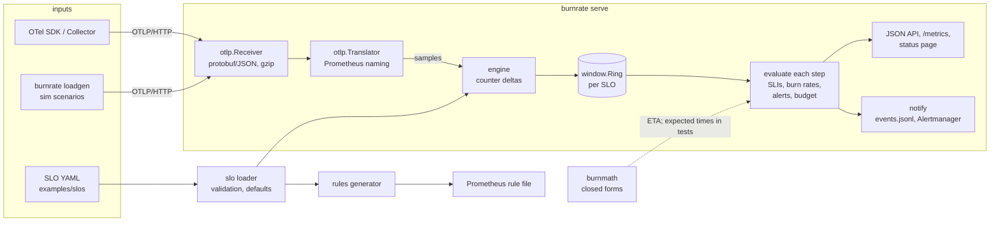

# burnrate

An SLO engine in Go. It ingests OpenTelemetry metrics over OTLP/HTTP
(protobuf or JSON), computes availability and latency-threshold SLIs,
evaluates **multiwindow, multi-burn-rate alerts** exactly as the Google SRE
workbook describes them, keeps **error-budget accounting with policy states**,
and **generates the equivalent Prometheus recording and alerting rules** from
the same OpenSLO-like YAML, with a test that proves the two agree.

```
$ burnrate math --slos examples/slos --slo checkout-availability
ERROR RATIO  BURN    PAGE DETECT  PAGE RESET  TICKET DETECT  TICKET RESET  BUDGET GONE IN
100.0%       1000x   51.8s        29.8m       4.3m           6.0h          43.2m
2.0%         20.0x   43.2m        21.0m       3.6h           5.7h          36.0h
0.5%         5.00x   never        never       14.4h          4.8h          6.0d
```

## Why

Burn-rate alerting is the standard answer to "page on symptoms, not causes",
but it is easy to get subtly wrong: averaging ratios instead of counting
events, forgetting that an SDK creates the error series lazily (so the first
errors of an outage vanish from `rate()`), mis-scaling 14.4x to a 7-day SLO,
or having no idea when an alert will actually fire. burnrate makes each of
those explicit and tested:

* the alert math is closed form (`internal/burnmath`), printed by
  `burnrate math`, and derived step by step in
  [docs/ALERT_MATH.md](docs/ALERT_MATH.md);
* the engine is tested to **fire and clear at the minute the workbook formula
  predicts**, for seven incident shapes;
* the generated Prometheus rules are run inside Prometheus' own TSDB and rule
  manager against the same OTLP traffic, and must fire and resolve the same
  alerts as the engine.

**Who it is for:** SRE and platform engineers who want to see, test and
explain SLO alerting before they trust it; teams that want rules for an
existing Prometheus; anyone learning the workbook's method who wants a
simulator that shows when alerts fire.

## Features

* **OTLP/HTTP receiver** - `POST /v1/metrics`, protobuf and JSON, gzip,
  body limits, `partialSuccess` for rejected points. Metric and label names
  are translated with Prometheus' own rules (`otlptranslator`,
  `UnderscoreEscapingWithSuffixes`), so SLO selectors use the names you
  already query in Prometheus.
* **SLIs** - ratio (bad/total or good/total) and latency threshold ratio
  (histogram bucket `le=threshold` over `_count`). Cumulative and delta
  temporality; counter resets; lazily created series handled.
* **Multiwindow, multi-burn-rate alerts** - workbook defaults (2%/1h, 5%/6h
  page; 10%/1d, 10%/3d ticket; short window = long/12) expressed as budget
  fractions so they scale to any period, or explicit burn rates per pair.
* **Error budget** - consumed/remaining over the rolling period, policy
  states with actions (default healthy / warning / critical / exhausted),
  exhaustion ETA.
* **Prometheus rules generator** - recording rules per window from raw
  counters, budget and policy-state recordings, one alert per severity.
  Validated with Prometheus' `rulefmt` + PromQL parser in tests, and with
  `promtool check rules` / `promtool test rules` via `make promtool-check`.
* **Synthetic traffic generator** - 8 deterministic incident scenarios emitted
  as real OTLP protobuf (in-process with `simulate`, over HTTP with `loadgen`).
* **Server** - JSON API, Prometheus `/metrics`, text status page, JSON-lines
  event log, Alertmanager v2 notifications; wall-clock or data-clock
  evaluation.

## Architecture



Package by package, with algorithms and complexity:
[docs/ARCHITECTURE.md](docs/ARCHITECTURE.md). The alert arithmetic:
[docs/ALERT_MATH.md](docs/ALERT_MATH.md).

## Quick start

Requirements: Go 1.27+ (the module says `go 1.27.1`), and for `make check`
golangci-lint v2 (CI pins v2.13.2). Nothing needs Docker or the network after
the module download.

```sh
make build                      # bin/burnrate
make check                      # fmt, vet, lint, tests + 85% coverage gate, rules drift
make demo                       # offline end-to-end demo (output below)

bin/burnrate validate --slos examples/slos
bin/burnrate math     --slos examples/slos --slo checkout-latency
bin/burnrate rules    --slos examples/slos -o slo-rules.yaml
bin/burnrate scenarios
bin/burnrate simulate --slos examples/slos --scenario latency-regression

# live: receive OTLP on :4318 and push a scenario at it
bin/burnrate serve --slos examples/slos --clock data --events-log - &
bin/burnrate loadgen --scenario outage
curl -s localhost:4318/            # status page
curl -s localhost:4318/api/v1/slos # JSON
```

For real traffic, point an OpenTelemetry SDK or Collector's OTLP/HTTP
exporter at `http://<host>:4318` and run `serve` with the default wall clock.
`serve -h` lists the flags (resolution, lateness, series TTL, promoted
resource attributes, Alertmanager URL, event log, log format).

### An SLO

```yaml
apiVersion: burnrate/v1
kind: SLO
metadata:
  name: checkout-latency
  labels: {team: payments}
spec:
  service: checkout
  timeWindow: [{duration: 30d, isRolling: true}]
  objectives: [{target: 0.99}]
  indicator:
    latency:
      histogram: http_server_request_duration_seconds{job="checkout", http_response_status_code!~"5.."}
      threshold: 0.25          # must be a bucket bound
  budgetPolicy:
    states:
      - {name: healthy, minRemaining: 0.4, action: Release at normal cadence.}
      - {name: at-risk, minRemaining: 0,   action: Performance review before each release.}
    exhaustedAction: Freeze feature releases; latency fixes only.
```

Ratio SLIs use `indicator.ratio.{total, bad | good}`; `alerting.windows`
overrides the defaults with `{severity, longWindow, shortWindow, burnRate |
budgetConsumed}` (see [examples/slos/search.yaml](examples/slos/search.yaml)).

## Demo

`make demo` (script: [scripts/demo.sh](scripts/demo.sh)) validates the SLOs,
prints the alert math, replays a four-day incident scenario in process,
starts a real server on a loopback port, pushes the `outage` scenario through
OTLP/HTTP with `loadgen`, reads back the status page, event log and
`/metrics`, and generates the rules. Excerpts from a real run:

```
==> 3. Replay the 4-day incident-day scenario in process (OTLP protobuf -> translator -> engine)
Scenario incident-day: A bad day: a 12m checkout outage, a 3h latency regression and a 1h search brownout, with 3% volume noise.
Replayed 4d of traffic (5760 exports, 5760 evaluation steps) in 691ms.

Injected incidents:
  +3d02h00m  full-outage    checkout  100% errors for 12m
  +3d06h00m  slow-db        checkout  15% of successes slow for 3h
  +3d16h00m  index-rebuild  search    8% errors for 1h

Events (alerts and budget policy changes):
T+         EVENT            SLO                    DETAIL
+00h02m    budget           checkout-availability  no-data -> healthy (left 100.0%)
+00h02m    budget           checkout-latency       no-data -> healthy (left 50.4%)
+00h02m    budget           search-availability    no-data -> healthy (left 74.0%)
+3d02h01m  budget           checkout-availability  healthy -> warning (left 38.1%)
+3d02h01m  FIRING page      checkout-availability  1h/5m burn 16.6/192 > 14.4x
+3d02h02m  budget           checkout-availability  warning -> critical (left 17.0%)
+3d02h03m  budget           checkout-availability  critical -> exhausted (left -6.6%)
+3d02h03m  FIRING ticket    checkout-availability  3d/6h burn 1.09/8.61 > 1.00x
+3d02h42m  resolved page    checkout-availability  budget left -203.1%
+3d06h32m  budget           checkout-latency       healthy -> at-risk (left 39.9%)
+3d06h56m  FIRING page      checkout-latency       1h/5m burn 14.4/15.4 > 14.4x
+3d08h12m  resolved ticket  checkout-availability  budget left -185.0%
+3d08h25m  FIRING ticket    checkout-latency       3d/6h burn 1.00/6.51 > 1.00x
+3d08h42m  budget           checkout-latency       at-risk -> exhausted (left -0.1%)
+3d09h19m  resolved page    checkout-latency       budget left -5.3%
+3d14h49m  resolved ticket  checkout-latency       budget left -1.8%
+3d16h38m  FIRING page      search-availability    1h/5m burn 10.2/16.0 > 10.0x
+3d17h02m  resolved page    search-availability    budget left 62.2%
+3d17h53m  budget           checkout-latency       exhausted -> at-risk (left 0.0%)

==> 4. Over the wire: serve OTLP/HTTP on a loopback port, push the 'outage' scenario with loadgen
burnrate serve listening on http://127.0.0.1:49362 (data clock: evaluation follows sample timestamps)
sent 5760 OTLP exports (4d of outage traffic) to http://127.0.0.1:49362 in 2.708s; 0 points rejected

==> 6. Alert transitions written to the JSON-lines event log
2026-01-04T02:01:00Z  alert_firing  checkout-availability/page
2026-01-04T02:03:00Z  alert_firing  checkout-availability/ticket
2026-01-04T02:42:00Z  alert_resolved  checkout-availability/page
2026-01-04T08:12:00Z  alert_resolved  checkout-availability/ticket
```

Reading it: the 12-minute total outage pages one minute after onset (the
math says 51.8 s), the page holds until the 30-minute short window of the
6h/30m pair drains (12m + 30m = +42m), and the ticket holds for the 6-hour
short window of the 3d/6h pair (+6h12m). The budget numbers are dramatic
because only four days of traffic exist in the 30-day window; see
[Limitations](#limitations).

## Testing and verification

Every number in this README comes from a command in the repo:

| Claim | Command | Result (last run) |
|---|---|---|
| All gates pass | `make check` | fmt-check ok, `go vet` clean, golangci-lint `0 issues`, all 12 test packages ok, rules up to date |
| Statement coverage, each package by its own tests | `make cover` | **95.3%** of `internal/...` (gate: 85%; lowest package `slo` 90.7%) |
| Engine fires/clears at workbook times, to the minute | `go test ./internal/engine -run Workbook -v` | 7 incident shapes + headline numbers pass |
| Generated rules ≡ engine inside real Prometheus | `go test ./internal/rules -run MatchEngine -v` | 6 scenarios, same alerts, transitions within ±2 min, same final policy state |
| promtool accepts and unit-tests the rules | `make promtool && make promtool-check` | `SUCCESS: 47 rules found`; `test rules` `SUCCESS` |
| Every scenario fires exactly its expected alerts | `go test ./internal/sim -run EndToEnd -v` | 8/8 |
| Full pipeline throughput | `make bench` | 4-day `incident-day` replay (368,608 samples, 5,760 evaluation steps × 3 SLOs, incl. protobuf encode/decode): ~0.7 s/op on an Apple M1 Pro |
| 30-day window sum (43,200 one-minute buckets) | `make bench` | ~1 µs (`BenchmarkSum30d`); bucket add ~10 ns |
| Source size | `git ls-files '*.go' \| grep -v _test.go \| xargs wc -l` | 5,245 lines of non-test Go; 3,749 lines of tests |

The test suite takes about a minute; most of it is the Prometheus equivalence
test, which replays days of traffic through a real TSDB.

## How it works

The full list with trade-offs is in [DECISIONS.md](DECISIONS.md). The main ones:

* **Selectors, not queries.** SLIs are PromQL series selectors. That is the
  language both the engine and `rate()` evaluate identically, which is what
  makes "equivalent rules" a testable claim rather than a hope.
* **Prometheus counter semantics, plus one fix.** First samples are baselines
  (as in `rate()`), except when the OTLP start time proves the series started
  from zero, otherwise the first errors of every outage would disappear.
* **Exact event counting.** Ring buffers of bucketed counts with block sums;
  window ratios are always `Σbad / Σtotal`, never averages of ratios.
* **Budget fractions, not magic numbers.** 14.4/6/3/1 are derived from
  2%/5%/10%/10% of a 30-day budget, so a 7-day SLO gets correctly scaled
  thresholds.
* **Prometheus is a test dependency only.** The binary links the OTLP protos
  and `otlptranslator`; Prometheus' TSDB, rule manager and parser are used in
  tests to validate against the real thing.

## Limitations

* **All traffic is synthetic.** The scenarios are generated by
  `internal/sim` with exact incident boundaries; burnrate has not been run
  against production traffic. See [DATA.md](DATA.md).
* **No persistence.** Engine state is in memory; after a restart, windows and
  budgets rebuild from zero (30 days for a 30-day budget). Production users
  who need continuity should deploy the generated Prometheus rules, which
  read history from the TSDB.
* **Young-window budgets.** Budget is computed over the events actually seen
  in the period, as `rate(x[30d])` is. In the first period after deployment
  one incident can show as −145% budget left; it would be ~28% of a full
  30-day budget.
* **SLI scope.** Occurrences-based budgeting only (no Timeslices), rolling
  windows only (no calendar months), one objective per SLO, selectors only
  (no joins or arbitrary PromQL), counters and explicit-bucket histograms only
  (gauges, summaries and exponential histograms are ignored).
* **Latency thresholds must be bucket bounds.** Bounds are only known at
  runtime, so a threshold that is not one silently selects no good series and
  the SLI reads 100% errors (every alert fires, loud, but confusing).
* **Gaps in a series are not back-filled.** A series that is not exported
  for longer than `--series-ttl` and then returns with the same start time
  re-establishes a baseline (it does not page on its lifetime count), so
  errors that accrued while it was not exported are never counted; windows
  in Prometheus that span the gap would count them.
* **Single process.** No sharding or HA; per-series state is in one map per
  selector. Sized for a handful of services' SLOs, not a fleet.
* **Equivalence tolerance.** Engine and Prometheus transitions are compared
  within ±2 minutes because `rate()` extrapolates; the engine's own timing is
  pinned to the minute by separate tests.
* **Alertmanager integration** is covered by tests against a fake HTTP
  server, not a real Alertmanager.

## Roadmap

* Persist ring state (snapshot + replay) so restarts keep budgets.
* Detect latency thresholds that match no bucket at runtime and surface them
  in the status API instead of reporting 100% errors.
* Timeslices budgeting and calendar-aligned windows.
* Exponential (native) histogram support for latency SLIs.
* Optional recording-rule cascade for long windows to cut Prometheus query
  cost on large servers.
* OpenSLO v1 import for files whose indicators are plain selectors.

## License

MIT, see [LICENSE](LICENSE).

## Maintainer

Maintained by **Love Kush Pranu**, Software Developer.

- GitHub: [lutherleo](https://github.com/lutherleo)
- LinkedIn: [lovekush-pranu](https://linkedin.com/in/lovekush-pranu)
- Email: [lp2989@nyu.edu](mailto:lp2989@nyu.edu)