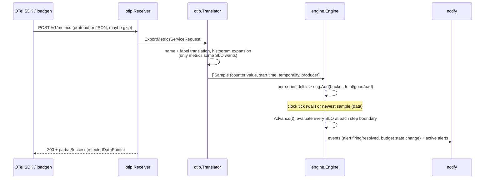

# Architecture

burnrate is one Go binary with two jobs that must agree with each other:

1. **Evaluate SLOs in process.** Receive OTLP/HTTP metrics, turn counters into
   per-SLO event counts, and every step compute error ratios, burn rates,
   multiwindow multi-burn-rate alerts and error-budget states.
2. **Generate Prometheus rules** that compute the same things from the same
   series, for teams that already run Prometheus.

The design choice that makes the two agree is that an SLO's indicator is
written as **PromQL series selectors** (`metric{label=~"..."}`), not as
free-form queries. A selector is something the engine can match against
incoming samples and something Prometheus can put inside `rate()`. And the
OTLP translation reproduces Prometheus' own metric and label naming, so both
sides see series with identical names.

## Module map

```
cmd/burnrate          main: hands os.Args to internal/cli
internal/
  series      label model + PromQL selector parser/matcher (cross-checked against Prometheus' parser)
  slo         SLO YAML (OpenSLO-like) -> validated model; workbook default windows; budget policy
  burnmath    closed-form burn-rate, detection, reset and exhaustion arithmetic
  window      two-level ring buffer of (total, good, bad) bucket counts
  engine      counter-aware ingestion, per-step evaluation, alerts, budget, events
  otlp        OTLP/HTTP receiver (protobuf + JSON, gzip) and client; Prometheus-compatible translation
  rules       Prometheus recording + alerting rule generator
  sim         deterministic OTLP traffic generator and incident scenarios
  notify      JSON-lines event log, Alertmanager v2 notifier
  server      HTTP server: OTLP endpoint, JSON API, /metrics, wall/data clocks
  report      text tables for the CLI and status page
  cli         commands: serve, validate, rules, math, simulate, loadgen, scenarios
```

Dependencies point downward: `series` and `burnmath` depend on nothing in the
repo; `slo` on those two; `window` on nothing; `engine` on `slo`, `series`,
`window`, `burnmath`; `otlp` on `engine` and `series`; `rules` only on `slo`;
`server` and `cli` wire everything together.

## Data flow



## Key algorithms

### OTLP translation (`internal/otlp`)

The translator mirrors Prometheus' default OTLP configuration
(`UnderscoreEscapingWithSuffixes`) using the upstream `otlptranslator`
package for metric names: `http.server.request.duration` in seconds becomes
`http_server_request_duration_seconds`; a histogram expands to `_bucket{le}`,
`_count` and `_sum`; monotonic counters get the `_total` suffix. Attributes are sanitized
into label names; `service.namespace/service.name` becomes `job` and
`service.instance.id` becomes `instance`; a configurable list of resource
attributes is promoted onto series. Before expanding a metric it asks the
engine `Wants(name)`, so unrelated metrics cost a map lookup, not label work.

Gauges, non-monotonic sums, exponential histograms and summaries are counted
as ignored, not rejected. Points that cannot be counters — no timestamp, no
value, unspecified temporality, unsorted bounds, bucket counts that do not add
up to the count — are rejected and reported through OTLP `partialSuccess`.

Cost: `O(points × labels)` for wanted metrics, `O(1)` per unwanted metric.

### Counter handling (`internal/engine/engine.go`)

The engine keeps, per (SLO selector, series), the last value, time and start
time. A sample's contribution is:

* **delta temporality:** its value;
* **cumulative:** `value − last`; a decrease or a newer OTLP start time is a
  reset and contributes the whole value; a duplicate or out-of-order sample
  contributes nothing (counted in stats);
* **first sample of a series:** a baseline (contributes 0), like Prometheus'
  `rate()`, *unless* the stream provably started from zero: its start time is
  after the engine began observing, or the same producer with the same start
  time has already exported without this series. The second rule is what
  makes lazily created error series (an SDK creates the `500` series on the
  first error) count their first errors.

Per-series state not updated for `--series-ttl` is evicted, leaving a
tombstone on its producer. If the same producer (same start time) exports the
series again, which OpenTelemetry asynchronous instruments do when a callback
stops and later resumes observing an attribute set, the returning value is a
lifetime count, so it is a baseline: neither first-sample exception applies.
A producer silent for `--series-ttl` is retired with its tombstones and
restored if it exports again (a partition, not a restart); it is forgotten
once silent for the longest SLO window. Without this, a returning series'
whole value lands in one bucket and pages with zero new errors, where `rate()`
sees no increase. Tombstones cost one string per evicted series for the
producer's lifetime plus that retention. Cost per sample: `O(m)` where `m` is
the number of selectors on that metric name.

### Ring buffer (`internal/window/ring.go`)

Each SLO has one ring of `(total, good, bad)` counts in fixed-width buckets
(the resolution, default 1m), sized to its longest window (normally the
period). Buckets are right-closed, `(k·res, (k+1)·res]`, so an evaluation at
`T` includes samples stamped exactly at `T`.

Buckets are grouped in blocks of 64 with running block sums:

| Operation | Cost | Notes |
|---|---|---|
| `Add(t, c)` | O(1) | updates one bucket and one block sum; out-of-order writes are fine |
| `Sum(end, w)` over n buckets | O(n/64 + 128) | whole blocks via block sums, partial blocks bucket by bucket |
| advance by k buckets | O(k + 64·touched blocks) | touched blocks are recomputed from their buckets, so float error never accumulates across laps |
| memory | 24 B × buckets | 30d at 1m ≈ 43,264 buckets ≈ 1 MB per SLO |

A 30-day sum touches ~676 block sums and at most 128 buckets
(`BenchmarkSum30d`: ~1 µs, `BenchmarkAdd`: ~10 ns on an M1 Pro). The ring is property-tested
against a naive map-of-buckets reference under random adds, advances and
window sums (`internal/window TestMatchesNaiveReference`).

### Evaluation step (`internal/engine/eval.go`)

`Advance(to)` evaluates every SLO at each resolution boundary in
`(lastEval, to]` (after a gap longer than the largest window, only the last
retention's worth of steps can change anything, so the rest are skipped).
For one SLO at time `t`:

1. for each distinct window (alert windows + period): `Sum(t, w)`, error
   ratio (`bad/total`, or `1 − good/total` clamped at 0), burn rate;
2. budget: `remaining = 1 − bad_P / ((1−O) · total_P)`, then the policy state;
3. for each severity, each pair is active iff both windows' ratios exceed
   `B·(1−O)` (NaN = no data never fires); the severity fires iff any pair is
   active; transitions become events;
4. exhaustion ETA from the burn rate of the shortest alerting long window.

Cost per step: `O(SLOs × windows × (n/64 + 128))`. The full four-day
`incident-day` replay (5,760 OTLP exports, 368,608 samples, 3 SLOs) runs in
~0.7 s including protobuf encode/decode (`make bench`).

The arithmetic and its discretisation are in [ALERT_MATH.md](ALERT_MATH.md).

### Rule generation (`internal/rules`)

One rule group per SLO, so Prometheus evaluates the recordings before the
alerts that read them in the same cycle:

* `slo:sli_error:ratio_rate<W>` for every window, always from raw counters —
  `sum(rate(bad[W])) / sum(rate(total[W]))` — never by averaging shorter
  ratios. Ratio SLIs are `clamp_max(..., 1)`; good-event and latency SLIs are
  `clamp_min(1 − good/total, 0)`. `or vector(0)` on the numerator keeps the
  ratio at 0 (not absent) before the first error series exists; `> 0` on the
  denominator makes it absent with no traffic, matching the engine's NaN.
* `slo:objective:ratio`, `slo:error_budget:ratio`,
  `slo:error_budget_remaining:ratio`, and one
  `slo:error_budget_policy_state{state=...}` rule per policy state whose
  ranges partition the line exactly like `Policy.Evaluate`.
* one alert per severity (default name `ErrorBudgetBurn`, `severity` label),
  OR-ing its `(long > thr and short > thr)` pairs. Thresholds are written as
  `B * (1 - O)` so PromQL does the same float64 operations as the engine.
  There is no `for:` clause: the long window already provides the delay.

Output is deterministic (sorted labels, stable order) and pinned by a golden
file; `make check` regenerates it and fails on drift.

### Traffic generator (`internal/sim`)

A `Scenario` is services (rate per step, baseline error ratio, latency
profile over the OTel default buckets) plus incidents (error ratio or "slow"
ratio for a time span). The `Generator` emits one OTLP
`ExportMetricsServiceRequest` per step, shaped like an SDK's
`http.server.request.duration` histogram: cumulative temporality, a series
per status code, error series created lazily on the first error. Errors and
bucket counts are allocated with carried remainders, so a 2% incident is
exactly 2% over any whole number of steps — that is what lets tests assert
alert times to the minute. Volume noise is optional and seeded.

### Server (`internal/server`)

`serve` hosts `POST /v1/metrics` (OTLP/HTTP), `GET /api/v1/slos[/{name}]`,
`/api/v1/events`, `/api/v1/alerts`, `/metrics` (Prometheus text format of
burnrate's own SLO gauges and ingest counters), `/healthz` and a text status
page at `/`. Two clocks:

* **wall** (default): a ticker evaluates every resolution step up to
  `now − lateness`, so late samples within the allowance still land in the
  right bucket; samples further than 5m in the future are dropped.
* **data**: evaluation follows the newest sample timestamp, so a recorded or
  simulated stream can be replayed as fast as it can be sent (used by
  `make demo` and the equivalence test's counterpart).

Notifiers run after each evaluation round: a JSON-lines event log, and an
Alertmanager v2 client that posts the active set at least every resend
interval with `endsAt = now + 4 × interval` (so Alertmanager keeps them alive
but expires them if burnrate dies), and resolved alerts with `endsAt` set to
the resolution time.

## Testing strategy

| Layer | What | Where |
|---|---|---|
| unit | selector parser vs Prometheus' parser; durations; SLO validation errors | `series`, `slo` |
| property | ring vs naive reference; window sums under random ops | `window` |
| fuzz | selector parser (`FuzzParse`, seeds committed) | `series` |
| closed form | workbook burn rates, detection/reset times | `burnmath` |
| behavioural | engine fires/clears at workbook times for 7 incident shapes | `engine TestWorkbookDetectionAndResetTimes` |
| integration | every scenario through protobuf → receiver → engine | `sim TestScenariosEndToEnd` |
| equivalence | same OTLP into Prometheus TSDB + rule manager vs engine | `rules TestGeneratedRulesMatchEngine` |
| golden | generated rules for the examples; Prometheus rulefmt + PromQL parse | `rules` |
| external | `promtool check rules` + `promtool test rules` | `make promtool-check` |
| CLI/server | every command, HTTP API, loadgen against a live server | `cli`, `server` |
